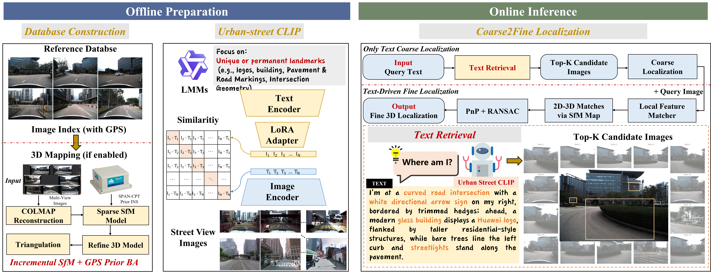

# TextVLoc



TextVLoc is a text-driven visual localization framework built on [HLOC](https://github.com/cvg/Hierarchical-Localization). It uses Urban Street CLIP to retrieve geo-tagged street-view images from natural-language descriptions, with optional region reranking and geometric pose refinement.

## Installation

```bash
docker build -t textvloc .
docker run --gpus all -it \
  --name textvloc-dev \
  --shm-size 16g \
  -v $(pwd):/workspace/TextVLoc \
  -w /workspace/TextVLoc \
  -e PYTHONPATH=/workspace/TextVLoc \
  textvloc bash
```

## Data

Download and extract the UrbanV2X image and metadata packages into the project root:

```bash
wget https://github.com/PolyU-TASLAB/TextVLoc/releases/download/textvloc-urbanv2x-data-v1/textvloc_urbanv2x_images.tar.gz
wget https://github.com/PolyU-TASLAB/TextVLoc/releases/download/textvloc-urbanv2x-data-v1/textvloc_urbanv2x_metadata.tar.gz
tar -xzf textvloc_urbanv2x_images.tar.gz
tar -xzf textvloc_urbanv2x_metadata.tar.gz
```

Expected data layout:

```text
datasets/SensorKit/
├── allcams/
├── query/cam1_all/
├── 0620_gt/
└── clipdata/
```

Fine localization also requires a reference SfM model and matching local features. The [minimal UrbanV2X SfM release](https://github.com/PolyU-TASLAB/TextVLoc/releases/tag/textvloc-urbanv2x-sfm-v1) provides the model; reference local features must be prepared separately with the same keypoint ordering.

## Training

Set the training and validation paths in the script, then run:

```bash
bash scripts/run_clip_training_experiments.sh
```

The pretrained Urban Street CLIP LoRA adapter is provided at `checkpoints/text8_visual12_epoch22.pt`.

## Usage

Run text-only localization with the supplied model:

```bash
python3 -m hloc.pipelines.RobotCar.clip_hloc \
  --dataset datasets/SensorKit \
  --outputs outputs/SensorKit_hloc/allcams_spatial_colmap_0630_CAM1_0.025 \
  --num_loc 20 \
  --caption_model qwen-vl \
  --clip_model_id laion/CLIP-ViT-L-14-DataComp.XL-s13B-b90K \
  --lora_ckpt_path checkpoints/text8_visual12_epoch22.pt \
  --positive_pairs_csv datasets/SensorKit/query/cam1_all/05_allcams_positive_pairs_for_eval.csv \
  --text_only_loc
```

To enable region reranking, add:

```bash
--enable_region_rerank --region_grid 3 --region_top_k 20 --region_reduce max --region_alpha 0.75
```

For geometric localization with a query image, remove `--text_only_loc` and prepare the reference SfM model under `outputs/SensorKit_hloc/allcams_spatial_colmap_0630_CAM1_0.025/sfm_superpointmax+lightglue`.

## Acknowledgements

[HLOC](https://github.com/cvg/Hierarchical-Localization), [COLMAP](https://colmap.github.io/), OpenCLIP, and the Hugging Face model ecosystem.
