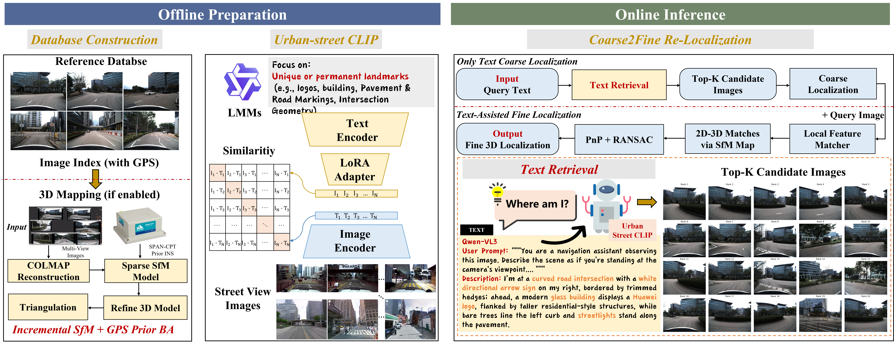

# TextVLoc



TextVLoc is a text-guided visual localization pipeline built on top of [Hierarchical-Localization (HLOC)](https://github.com/cvg/Hierarchical-Localization). It uses Urban Street CLIP, a LoRA-adapted CLIP retriever for urban street-view text-image matching, as the coarse retrieval module. This project targets the `SensorKit` setup in this repository and combines:

- VLM caption generation for query images
- CLIP-style text-image retrieval
- LoRA fine-tuning for domain adaptation
- Optional region reranking for better retrieval quality
- Optional geometric localization with local feature matching and PnP

The codebase is currently organized around the `SensorKit` dataset layout already used in this workspace.

## Features

- Text-only localization from retrieved database poses
- Retrieval with pretrained CLIP / SigLIP / MetaCLIP / LongCLIP backbones
- Urban Street CLIP LoRA fine-tuning in `train_localclip.py`
- Region-aware reranking with `--enable_region_rerank`
- Geometric localization using SuperPoint + LightGlue + `pycolmap`
- Recall evaluation with `--positive_pairs_csv`

## Text Used For Retrieval

This project does not retrieve directly from raw query images. It first converts each query image into a text description, then retrieves database images with a CLIP-style model.

### Inference-time text

The current default inference setup uses:

- caption backend: `qwen-vl`
- actual VLM: `Qwen/Qwen3-VL-8B-Instruct`
- generated file pattern: `qwen3_query_prompts_qwen-vl_77clip10.csv`

Each query image is described with a fixed navigation-oriented prompt in [hloc/generate_captions.py](hloc/generate_captions.py). The generated text is intended to be:

- first-person viewpoint
- focused on static landmarks and road structure
- a single complete sentence
- under 77 words

This design is meant to fit CLIP-style text retrieval better than generic image captions.

### Training-time text

The current training script [scripts/run_clip_training_experiments.sh](scripts/run_clip_training_experiments.sh) launches `train_localclip.py` with:

- `TRAIN_CSV=datasets/SensorKit/clipdata/clipdata_prepare_sparse03_remove/00_train_qwen3.csv`
- `VAL_CSV=datasets/SensorKit/clipdata/astri_412_down03/val_qwen3.csv`
- `--out-dir datasets/SensorKit/clipdata/finetune_output/qwen3_clipdata_text_sparse03_remove/`

The training script now uses only the main CSV `description` field for LoRA fine-tuning, while the online localization pipeline currently uses the short `77`-word navigation descriptions for retrieval.

## Repository Layout

```text
.
├── hloc/                                  # HLOC code and TextVLoc pipeline
├── scripts/                               # training / evaluation helper scripts
├── train_localclip.py                     # LoRA fine-tuning entrypoint
├── requirements-clip-hloc.txt            # Python dependencies
├── Dockerfile                             # Reproducible CUDA environment
├── datasets/SensorKit/                    # local dataset root (not tracked)
└── outputs/SensorKit_hloc/                # local experiment outputs (not tracked)
```

## Expected Local Data Layout

This project assumes the following directories already exist locally:

```text
datasets/SensorKit/
├── allcams/                               # database / mapping images
├── query/cam1_all/0_undistorted/          # query images
├── 0620_gt/
│   ├── enu_all_mapping_gt.csv
│   └── enu_all_query_gt.csv
├── allcams_spatial_colmap_0630/           # COLMAP assets
└── clipdata/                              # CLIP fine-tuning data and checkpoints
```

The default pipeline also expects an existing reference SfM model under:

```text
outputs/SensorKit_hloc/allcams_spatial_colmap_0630_CAM1_0.025/sfm_superpointmax+lightglue
```

## Environment Setup

### Option 1: local Python environment

```bash
python3 -m venv .venv
source .venv/bin/activate
pip install --upgrade pip
pip install -r requirements-clip-hloc.txt
```

Notes:

- `pycolmap` and GPU-enabled dependencies should match your CUDA / PyTorch environment.
- Some models are downloaded from Hugging Face on first use.

### Option 2: Docker

```bash
docker build -t textvloc .
docker run --gpus all -it --rm \
  -v $(pwd):/app \
  -v /path/to/your/datasets:/app/datasets \
  textvloc
```

## Training

The main training entrypoint is:

```bash
bash scripts/run_clip_training_experiments.sh
```

That script currently launches `train_localclip.py` to train Urban Street CLIP with:

- text-only LoRA adaptation (`--lora-target text`)
- main CSV descriptions as the only training text source
- cross-attention enabled

You can modify dataset paths, output paths, batch size, and epochs directly in `scripts/run_clip_training_experiments.sh`.

## Inference and Evaluation

The current command-line entrypoint still uses the legacy Python module path
`hloc.pipelines.RobotCar.clip_hloc` for compatibility.

### 1. Text-only localization

This mode retrieves database images from text prompts and directly uses the top retrieved database pose.

```bash
python3 -m hloc.pipelines.RobotCar.clip_hloc \
  --dataset datasets/SensorKit \
  --outputs outputs/SensorKit_hloc/allcams_spatial_colmap_0630_CAM1_0.025 \
  --num_covis 10 \
  --num_loc 20 \
  --caption_model qwen-vl \
  --clip_model_id laion/CLIP-ViT-L-14-DataComp.XL-s13B-b90K \
  --lora_ckpt_path datasets/SensorKit/clipdata/finetune_output/qwen3_clipdata_text_sparse03_remove/lora_epoch_22.pt \
  --positive_pairs_csv datasets/SensorKit/query/cam1_all/05_allcams_positive_pairs_for_eval.csv \
  --text_only_loc
```

### 2. Text-only localization with region reranking

Add region reranking on top of the text retrieval stage:

```bash
python3 -m hloc.pipelines.RobotCar.clip_hloc \
  --dataset datasets/SensorKit \
  --outputs outputs/SensorKit_hloc/allcams_spatial_colmap_0630_CAM1_0.025 \
  --num_covis 10 \
  --num_loc 20 \
  --caption_model qwen-vl \
  --clip_model_id laion/CLIP-ViT-L-14-DataComp.XL-s13B-b90K \
  --lora_ckpt_path datasets/SensorKit/clipdata/finetune_output/qwen3_clipdata_text_sparse03_remove/lora_epoch_22.pt \
  --positive_pairs_csv datasets/SensorKit/query/cam1_all/05_allcams_positive_pairs_for_eval.csv \
  --text_only_loc \
  --enable_region_rerank \
  --region_grid 3 \
  --region_top_k 20
```

Useful extra flags:

- `--evaluate_rerank_recall`
- `--region_top_m 2`
- `--region_alpha 0.5`

You can also run the helper script:

```bash
bash scripts/test_with_rerank.sh
```

### 3. Geometric localization with PnP

To enable image-based geometric localization, remove `--text_only_loc`. The pipeline will:

1. generate captions for query images
2. retrieve candidate database images with CLIP
3. convert retrieval results to matching pairs
4. run SuperPoint + LightGlue matching
5. estimate poses with `localize_sfm.main(...)`

Example:

```bash
python3 -m hloc.pipelines.RobotCar.clip_hloc \
  --dataset datasets/SensorKit \
  --outputs outputs/SensorKit_hloc/allcams_spatial_colmap_0630_CAM1_0.025 \
  --num_covis 10 \
  --num_loc 20 \
  --caption_model qwen-vl \
  --clip_model_id laion/CLIP-ViT-L-14-DataComp.XL-s13B-b90K \
  --lora_ckpt_path datasets/SensorKit/clipdata/finetune_output/qwen3_clipdata_text_sparse03_remove/lora_epoch_22.pt \
  --positive_pairs_csv datasets/SensorKit/query/cam1_all/05_allcams_positive_pairs_for_eval.csv
```

If you want both reranking and geometric localization, keep `--enable_region_rerank` and omit `--text_only_loc`.

## Helper Scripts

- `scripts/run_clip_training_experiments.sh`: LoRA training
- `scripts/test_all_clip_models.sh`: compare pretrained retrieval backbones
- `scripts/test_all_loras.sh`: sweep LoRA checkpoints
- `scripts/test_with_rerank.sh`: evaluate region reranking
- `scripts/opposite_view/`: opposite-view retrieval protocols for Oxford RobotCar, SYNTHIA SEQS-02, and UrbanV2X

## Demo Rendering

You can render the localization process into a local HTML viewer and optionally an MP4 video with:

```bash
python3 tools/render_localization_demo.py \
  --query-dir datasets/SensorKit/query/cam1_all/0_undistorted \
  --db-dir datasets/SensorKit/allcams \
  --reference-sfm outputs/SensorKit_hloc/allcams_spatial_colmap_0630_CAM1_0.025/sfm_superpointmax+lightglue \
  --retrieval outputs/SensorKit_hloc/allcams_spatial_colmap_0630_CAM1_0.025/pairs-query-clip20-qwen-vl.txt \
  --results outputs/SensorKit_hloc/allcams_spatial_colmap_0630_CAM1_0.025/SensorKit_hloc_superpoint+superglue_clip20_qwen-vl_lora_epoch_22.txt \
  --prompts-csv outputs/SensorKit_hloc/allcams_spatial_colmap_0630_CAM1_0.025/qwen3_query_prompts_qwen-vl_77clip10.csv \
  --queries outputs/SensorKit_hloc/allcams_spatial_colmap_0630_CAM1_0.025/queries_with_intrinsics.txt \
  --output-dir outputs/SensorKit_hloc/allcams_spatial_colmap_0630_CAM1_0.025/demo
```

This writes:

- `index.html`: local browser viewer with play/pause and frame scrubbing
- `frames/frame_*.png`: composed visualization frames
- `manifest.json`: frame metadata for the viewer

To also export a video:

```bash
python3 tools/render_localization_demo.py ... --output-dir outputs/.../demo --export-mp4 --fps 5
```

If `results_logs.pkl` is present next to `--results`, the renderer will try to add a match/inlier panel. Otherwise it falls back to retrieval + pose visualization only.

## Reproducibility Notes

- This repository does not track `datasets/`, `outputs/`, checkpoints, or generated features by default.
- The current pipeline is tightly coupled to the `SensorKit` directory structure and several hard-coded paths.
- If you plan to publish the project publicly, document how others can obtain `SensorKit` data or provide a script that rebuilds the required folder layout.
- If you need to version checkpoints or sample outputs, use Git LFS instead of normal Git.

## Acknowledgements

- [Hierarchical-Localization (HLOC)](https://github.com/cvg/Hierarchical-Localization)
- [COLMAP](https://colmap.github.io/)
- OpenCLIP / Hugging Face model ecosystem
